<p align="center">
  
</p>

<p align="center">
  <a href="https://github.com/Starktastic-Homelab/packer/actions/workflows/build.yml"></a>
  <a href="https://github.com/Starktastic-Homelab/packer/actions/workflows/i915-compat.yml"></a>
  <a href="https://github.com/Starktastic-Homelab/packer/actions/workflows/check-debian-iso.yml"></a>
</p>

This repository builds three Debian 13 VM templates (ADR 0017): base (VM 900) from the ISO, and k3s
(VM 901) and storage (VM 902), both cloned from the base. Every K3s node in the homelab is cloned from the
k3s template. The k3s image carries a DKMS build of the Intel i915 SR-IOV driver, so most of the work here
is not the install but the gates around it: a pull request cannot merge a driver and kernel pair that
upstream does not support, and a build fails rather than ship a template whose driver did not compile.

## Where it sits

<p align="center">
  
</p>

A push to `main` is a real build. It replaces templates 900 (base), 901 (k3s) and 902 (storage) on the
Proxmox host, publishes a GitHub release and opens two pull requests in
[terraform](https://github.com/Starktastic-Homelab/terraform), one for the k3s and one for the storage
entry of the image manifest. Nothing downstream moves until a person merges them. The
[organization profile](https://github.com/Starktastic-Homelab) shows the whole chain.

## How it works

### The build pipeline

<p align="center">
  
</p>

`build.yml` runs on every push to `main` and by hand; a push that touches only `README.md` or
`renovate.json` is skipped. Its three build jobs use the self-hosted runner, because Packer talks to the
Proxmox API. The `base` job runs first: the Debian installer in the new VM fetches its answers from
Packer's HTTP server on port 8000. The `k3s` and `storage` jobs then run in parallel, each cloning
template 900.

| Step | Job | Defined in | What happens |
|---|---|---|---|
| 1 | `base` | `source-base.pkr.hcl` | Packer creates VM 900 with the Debian 13 netinst ISO, checked against Debian's `SHA256SUMS`, and types a boot command that points the installer at the preseed. |
| 2 | `base` | `http/preseed.cfg.tmpl` | The installer runs unattended: one ext4 root partition, root login disabled, a temporary builder user, `openssh-server` and `qemu-guest-agent`. |
| 3 | `base` | `scripts/base.sh` | Upgrades every package; installs cloud-init; replaces ifupdown with netplan and systemd-networkd. No GPU stack and no compiler. |
| 4 | `base` | `cloud-init/` | Copied to `/etc/cloud`: NoCloud and ConfigDrive datasources, root disabled, a default user with passwordless sudo, and `growpart` so a clone with a larger disk grows its root filesystem. |
| 5 | `k3s` | `source-k3s.pkr.hcl`, `scripts/k3s.sh` | Packer clones 900 into VM 901. `k3s.sh` installs DKMS, kernel headers, the NFS client, Intel firmware and the VA-API driver; installs the i915 driver between two gates; removes ModemManager; sets the kernel command line. |
| 6 | `storage` | `source-storage.pkr.hcl`, `scripts/storage.sh` | Packer clones 900 into VM 902. `storage.sh` installs the LIO target (`targetcli-fb`, held), LVM with stock activation off (`event_activation = 0` in the main system and every initramfs, `lvm2` held, `lvm2-monitor` and `blk-availability` masked), nftables and the node exporter, and fails if a compiler is present. |
| 7 | all | `scripts/seal.sh` | Runs last in every build: resets the machine ID and the cloud-init state, and deletes the builder user and its sudoers file. Packer then turns the VM into a template. |
| 8 | all | `build-{base,k3s,storage}.pkr.hcl` | Each `manifest` post-processor writes `packer-manifest.json` with an entry named after its source (`base`, `k3s`, `storage`): the template name and the release tag, and for k3s the i915 release and its kernel series. |

Both gates in step 5 fail the build. Before the driver is installed, `k3s.sh` checks that the
running kernel and every kernel under `/lib/modules` are on the pinned series, so a Debian kernel bump
stops the build instead of installing a driver that cannot support it. After the install, DKMS has to
report the module as installed for the kernel the image boots. `dpkg -i` exits 0 even when the DKMS
compile fails, and one build shipped a template with the stock driver that way.

The order is `base`, then `k3s` and `storage`, then three jobs on GitHub-hosted runners. After `k3s`,
`create-release` publishes a release tagged `v<Debian version>.<build timestamp>` with the k3s manifest
attached, and `push-manifest` merges the k3s entry by name into terraform's `packer-manifest.json` on a
new branch `packer-build-<run>` and opens a pull request titled `Update k3s VM template (<template name>)`.
After `storage`, `push-storage-manifest` does the same for the storage entry on
`packer-build-<run>-storage`, titled `Update storage VM template (<template name>)`. Each merge keeps the
other entries, and the k3s entry stays at `builds[0]` until terraform selects by name. Merging the pull
requests is the only manual step.

| The templates | |
|---|---|
| Name | `packer-<template>-debian-<Debian version>-<build timestamp>`; base is VM ID 900, k3s 901, storage 902 |
| Hardware | q35, CPU type `host`, a 4G virtio disk with discard on `local-zfs`, a virtio NIC on `vmbr0`, QEMU guest agent, cloud-init drive |
| System | Debian 13, upgraded at build time, root login disabled, empty machine ID |
| Network | netplan with systemd-networkd and systemd-resolved; ifupdown is removed |
| GPU | k3s only: `i915-sriov-dkms` on the `2025.12.10.x` line for kernel 6.12, with the Intel VA-API driver and firmware |
| Storage | storage only: the LIO target, LVM, nftables and the node exporter; no compiler |

### The i915 compatibility gate

<p align="center">
  
</p>

The image runs as a guest of a Proxmox host that shares its Intel GPU through SR-IOV: the host drives
the physical function (PF) and the guest a virtual function (VF). Each side runs a release of
[`strongtz/i915-sriov-dkms`](https://github.com/strongtz/i915-sriov-dkms), and the two do not have to
match. The guest stays on the `2025.12.10.x` maintenance line because Debian 13 ships kernel 6.12, which
the newest releases do not support; the host runs a newer line on purpose.

What has to hold instead is checked by `i915-compat.yml` on every pull request to `main`. The workflow
has no path filter, so its job can be a required status check.

| Check | Where the answer comes from |
|---|---|
| Blocked host releases | `BLOCKED_HOST_RELEASES` in the script: releases that failed on this hardware although their metadata agreed. Checked first, before any network call. |
| 1. Guest driver supports the guest kernel | The kernel range in the release notes of the exact tag must cover `i915_sriov_kernel_series`. |
| 2. Host driver supports the host kernel | The same check against the pinned Proxmox kernel. |
| 3. PF and VF agree on an IOV ABI | The `IOV_VERSION_*` values in each tag's `iov_version_abi.h`, replayed through the upstream handshake. |

The guest pin comes from `debian.auto.pkrvars.hcl` in the pull request. The host pin is read from the
`main` branch of [ansible](https://github.com/Starktastic-Homelab/ansible): the release from
`group_vars/proxmox_hosts/i915_sriov.yml` and the pinned kernel from `roles/i915_sriov/defaults/main.yml`.
ansible carries a byte-identical copy of `scripts/i915_compat.py` and runs it the other way round,
reading the guest pin from this repository.

Unknown means fail. A missing tag, release notes without a kernel range, a missing ABI header or a
network failure all exit non-zero, and so does a pin the workflow cannot read. The checker's report is
posted as a sticky comment before the job fails. Renovate may only propose releases on the
`2025.12.10.x` line, and its pull requests go through the same check.

A green check proves metadata, not hardware: every report ends with a `Hardware acceptance: NOT TESTED`
notice. Only ansible's `i915-acceptance.yml` workflow proves the GPU on the running cluster.

**Guest kernel command line.** `scripts/k3s.sh` adds
`i915.enable_guc=3 i915.xelp_enable_ccs=1 module_blacklist=xe` to the GRUB default command line.
`i915.xelp_enable_ccs=1` matches the host PF, which runs with Xe_LP CCS on (47-bit PPGTT). Without it,
OpenCL and OpenVINO workloads hang the guest's `rcs0` engine. The parameter assumes the PF keeps CCS on,
so re-decide it with any host or guest driver change, and test OpenCL too.

## What is in the repo

| Path | What it is |
|---|---|
| `source-base.pkr.hcl` | The `proxmox-iso.base` source: Proxmox API, build VM hardware, ISO, boot command, preseed |
| `source-k3s.pkr.hcl`, `source-storage.pkr.hcl` | The `proxmox-clone.k3s` and `proxmox-clone.storage` sources, cloned from the base |
| `build-base.pkr.hcl`, `build-k3s.pkr.hcl`, `build-storage.pkr.hcl` | Each template's provisioners in order and its `manifest` post-processor |
| `config.pkr.hcl` | The Proxmox plugin pin and the template names |
| `variables.pkr.hcl` | Variable declarations and defaults: VM IDs, node, storage pools, bridge, build VM size |
| `debian.auto.pkrvars.hcl` | The three pins: Debian ISO, guest i915 release, guest kernel series |
| `http/preseed.cfg.tmpl` | The Debian installer's answers |
| `scripts/base.sh`, `scripts/k3s.sh`, `scripts/storage.sh` | In-guest provisioning per template; `k3s.sh` holds the two build gates |
| `scripts/seal.sh` | Seals every template: machine ID, cloud-init state, builder user |
| `files/storage/` | The `rtslib-fb-targetctl` drop-in the storage template installs |
| `cloud-init/` | `cloud.cfg` and the datasource list that end up in `/etc/cloud` |
| `scripts/i915_compat.py`, `scripts/tests/` | The compatibility checker (standard library only), its offline tests and the image layout tests |
| `.github/required-status-checks.json` | The required status checks for `main`, kept in Git |
| `renovate.json` | Renovate rules: GitHub Actions, the Packer plugin, and the i915 release held on its line |

## Workflows

| Workflow | Runs on | What it does |
|---|---|---|
| `build.yml` | push to `main`, manual | Builds the base, then the k3s and storage templates on the self-hosted runner, publishes a release, opens one manifest pull request per template in terraform |
| `validate.yml` | pull request | Runs `packer init` and `packer validate`; skipped when only `README.md` or `renovate.json` changed |
| `i915-compat.yml` | every pull request, manual | Runs the checker's tests, then checks the guest pin against the host pin in ansible and comments the report |
| `format.yml` | pull request, manual | Runs `packer fmt`, Prettier, shfmt and shellcheck, and commits the formatting to the branch |
| `check-debian-iso.yml` | Fridays 09:00 UTC, manual | Opens a pull request that bumps the ISO pin when Debian publishes a new netinst ISO |

Renovate bumps the GitHub Actions, the Packer plugin and the i915 release. It does not manage the ISO
pin; `check-debian-iso.yml` does. Packer itself is not pinned.

## Run it

Validate without touching Proxmox. The placeholder values are the ones `validate.yml` uses.

```sh
packer init -upgrade .
PKR_VAR_proxmox_api_url=https://proxmox.example.com:8006/api2/json \
PKR_VAR_proxmox_api_token_id=id PKR_VAR_proxmox_api_token_secret=secret \
  packer validate .
```

Test the image layout and the checker offline, then ask upstream about the guest pin alone.

```sh
python3 scripts/tests/test_image_layout.py
python3 scripts/tests/test_i915_compat.py
python3 scripts/i915_compat.py --guest-version 2025.12.10.2 --guest-kernel 6.12
```

Builds normally run in CI. A build by hand needs the real `PKR_VAR_proxmox_*` values and
`PKR_VAR_runner_host_ip` set to an address the new VM can reach on port 8000. It replaces templates 900,
901 and 902: base first, then the clones.

```sh
packer build -force -only='proxmox-iso.base' .
packer build -force -only='proxmox-clone.k3s' .
packer build -force -only='proxmox-clone.storage' .
```

## Operations

- [i915 SR-IOV: acceptance, checker and branch protection](docs/i915-sriov.md): hardware acceptance after
  a new image, the checker's command line and exit codes, applying the required status checks, and
  moving the guest to a newer driver line.
- [Security policy](SECURITY.md): how to report a vulnerability.
- Documentation changes outside `README.md` still start a build when they reach `main`. Put `[skip ci]`
  in the subject of the commit that lands there (for a pull request, the squash subject) to avoid one.

---

<p align="center">
  Part of <a href="https://github.com/Starktastic-Homelab"><b>Starktastic Homelab</b></a>:
  <a href="https://github.com/Starktastic-Homelab/packer">packer</a> ·
  <a href="https://github.com/Starktastic-Homelab/terraform">terraform</a> ·
  <a href="https://github.com/Starktastic-Homelab/ansible">ansible</a> ·
  <a href="https://github.com/Starktastic-Homelab/apps">apps</a><br>
  <sub>Product logos in the diagrams are trademarks of their owners and are used only to label the components.</sub>
</p>
